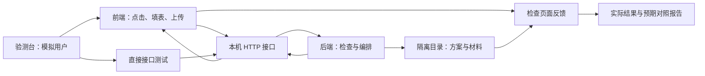

# 考场编排·验测台：测试设计与执行方案

日期：2026-10-06。对象：考场编排第一版及已批准的后续改进。测试只使用虚构资料。

## 1. 命名与本次交付范围

- 中文名：**考场编排·验测台**，简称「验测台」。
- 英文名：`exam-room-testbench`。将来需要独立 Python 包时使用 `exam_room_testbench`。
- 专业名称：自动化测试工具集（Test Harness）；其中包括规则测试、接口集成测试、端到端测试和回归测试。
- 定位：供开发和交付验收使用；不加入教师日常操作菜单，不常驻在前后端之间。

截至 2026-10-07，测试设计、场景、虚构资料、准备检查、统一执行器、真实 HTTP／浏览器脚本和中文报告已实现。实际通过情况见每次独立运行报告，不能用脚本存在代替通过。现有 `tests/` 保留并复用。

有三种做法：只做人工验收清单，容易遗漏回归；只增加接口测试，不能证明界面操作正确；采用分层验测台，复用现有测试、补齐完整操作及交付验收。本项目采用第三种，第一阶段用命令和本地报告即可，无需另外开发一套复杂管理软件。

## 2. 如何验证前端和后端的「对话」

同一操作检查五个环节：用户输入、实际请求、后端返回、界面反馈、保存／导出结果。例如交换固定座位后，页面须提示考号不匹配；旧考号保留；保存重开仍提示；正式导出被拦截；重新生成考号后提示消除，导出与座位一致。

接口路径和字段以 `exam_room/server.py`、`docs/数据协议.md` 为准。当前业务失败通常仍返回 HTTP 200，应检查 `{ok:false,error:中文说明}`，不能只看状态码。无口令或错误口令是 403；未知接口是 404。端到端测试必须使用真实本机后端，不用模拟接口替代编排、保存和导出。

## 3. 分层安排

| 层级 | 检查内容 | 执行方式 | 放行条件 |
|---|---|---|---|
| 数据准备 | 文件可读、数量、字段、前导零、故障样本及预期正确 | 本次准备脚本 | 全部检查成功；不代表软件验收通过 |
| 核心规则 | 日程、容量、座位、编号、混排、监考回避 | 现有 pytest + 补充用例 | 不漏排、不重复、硬规则不放宽 |
| 接口集成 | 导入、预览、保存、后台任务、取消、版本冲突、下载 | 实际启动 `start(app=隔离App, port=0)`，通过 HTTP 请求 | 业务状态、revision、落盘内容一致 |
| 端到端 | 教务人员完整操作、提示、错误恢复 | Python Playwright 操作实际页面 | 请求成功后界面与文件均正确；无控制台异常 |
| 报表核对 | Excel、HTML、PDF、16 类材料 | 读取导出文件 + PDF 渲染抽查 | 无漏人／错号／错座；前导零保留；无截断 |
| 稳定与性能 | 1,500 人、重复操作、取消、重启、文件异常 | 独立子进程测量，保留环境与耗时 | 可行或明确解释失败；不损坏方案 |
| 最终桌面验收 | pywebview、系统文件对话框、打印、许可、升级 | 源码全链路通过后才分别打包并实机操作 | Windows 与 Mac 各自记录；不能互相代替 |

继续使用 pytest 验证 Python 逻辑；浏览器层使用项目已有的 Python Playwright。浏览器验证不等于原生桌面窗口验证。pytest 的临时目录支持每例隔离；Playwright 推荐测试隔离及面向用户行为的断言。参考 [pytest 临时目录](https://docs.pytest.org/en/stable/how-to/tmp_path.html)、[Playwright 最佳实践](https://playwright.dev/docs/best-practices)。

## 4. 隔离与复现

1. 一次运行创建新的 `output/testbench/<运行编号>/`；每例独立工作目录、端口和浏览器上下文。样本目录只读，复制后操作。
2. 启动子进程前设置 `EXAM_ROOM_HOME`；或给 App 显式传入 root，同时传入测试 License。许可目录、方案、回收站、备份和导出均在该隔离目录。
3. 自动生成资料的学生、教师、学校均带虚构标识；固定种子 42、固定日期和实体 ID。求解器版本、系统、Git 提交、修改文件、Python 版本、fixture SHA-256 写入报告。
4. 不读取现有用户资料和正式许可记录，不上传学生资料；更新测试使用本机模拟服务／响应，不触发真实升级、退出或发布。
5. 许可测试使用内存中临时密钥和可控时钟；不操作系统时间、不使用正式私钥、不把激活码／X-Token 写进报告。到期后允许编排、查看、保存，导出／打印拒绝；激活后恢复。
6. 失败保存最小虚构方案、请求名称及已脱敏参数、错误、截图、控制台信息和重现步骤。运行结束关闭 HTTP 服务、浏览器、后台工作线程及子进程。
7. 超时、无解、取消、部分完成和测试异常分开记录；取消／失败／旧 revision 结果不得覆盖新编辑。随机座位在同环境同种子下检查复现；不要求多个最优解的监考教师顺序相同。

## 5. 核心规则矩阵

| 编号 | 范围 | 必须覆盖的情况与预期 |
|---|---|---|
| RULE-01 | 资料导入 | 四类 xlsx/csv；UTF-8 BOM/GB18030；多工作表与标题行；别名列；原始成绩列；同名不合并；前导零保留 |
| RULE-02 | 错误资料 | 缺必填、重复考号／学号、坏文件、未知版本、错误时段；中文定位问题，失败不部分写入 |
| RULE-03 | 日程 | 未安排自动填充；锁定保持；考试时长匹配；同年级无重叠；时段足够；教室可用；手输／全角冒号／±5 分钟／未保存行 |
| RULE-04 | 布局 | 横排/竖排 × 顺排/S 型；单人/双人桌；过道；停用；实际容量；01/99 边界、00/100 拒绝；屏幕与打印物理位置一致 |
| RULE-05 | 编排模式 | 班级交叉、随机、成绩、已有考号；同分稳定；缺成绩放最后；数字考号按数值、其他文本按字典序，文本本身不改 |
| RULE-06 | 混排 | 不混、七八混、全混、自定义组；禁混年级不共场；相同完整参试时段轮流交插；时段不兼容不能混；非重叠考试允许复用 |
| RULE-07 | 座位调整 | 锁定保留；交换／撤销；停用／重复座位拒绝；单科只含参试者、固定座位不变；50 步历史截断 |
| RULE-08 | 考号 | 自定前缀（2/3/4/5 位及前导零）；两位场号/座号；缺号补齐/全部重生/按年级范围；预览不保存；提交重验；10 次独立历史；人工改号保护 |
| RULE-09 | 监考 | 人数覆盖；任教学科／班级回避；不可用；同时间只能一场；锁定保持；清空、替换、撤销；不足给 partial 和具体空缺，不放宽规则 |
| RULE-10 | 统一检查 | 未编排也报缺失；硬问题拦截正式导出；提示不作为无解；改资料标记待复核；确认不能隐藏硬问题 |
| RULE-11 | 保存 | 原子保存、备份、复制、回收站删除/恢复、迁移；断电／写失败恢复；重启后方案与锁定历史完整 |
| RULE-12 | 并发 | 旧保存、预览后再改、求解中编辑/换方案/取消/重复点击；旧结果拒绝覆盖；页面解释并能继续操作 |
| RULE-13 | 材料 | 日程、总表、使用表、监考、工作量、分班、个人安排、准考证、名单、座次、门贴、桌贴、教师个人、签到，全部与该 revision 的方案一致 |
| RULE-14 | 安全／异常 | 无口令、错误 Host、未知接口；HTML 转义、公式样式文本；无外网时本机编排可用；文件被占用、权限不足、损坏文件均解释 |
| RULE-15 | 许可／更新 | 首次试用、临界时间、到期、错误机器码、错误码、激活恢复；旧方案兼容、升级保留资料和许可、错误摘要拒绝安装 |

参数组合采用小样本穷举（例如 2×2×2 种座号/桌型），完整流程选择代表组合；无需在 1,500 人上重复穷举。

## 6. 完整流程用例（软件完成后必跑）

### FLOW-01：教务正常工作，144 人

用 `testkit/fixtures/C02_normal_144/` 下四类表新建方案；核对七八九各 48 人、各 3 班、6 场、18 位教师、9 科考试。保留导入考号，先用已有日程排座、排监考；统一检查并确认；正式导出所有材料；关闭服务和页面后重开原目录加载原方案。

断言：144 名学生固定位置完整；逐场参试集合准确；无同时重复座位、禁混共场、教师冲突；学生总表 **432 条数据行**（不含标题表头）；编号文本保留；重开后关键数据、revision、锁定、种子、历史与关闭前相同。再用 C03 验证自动日程，使用 C04 验证人工锁定保留。

### FLOW-02：位置调整与考号一致性

打开 C01；交换七年级前两位学生固定座位。旧号码仍保留，2 人提示 `number_seat_mismatch`；正式导出拒绝，草稿标明草稿；预览前缀 `001`、重新生成并复核后问题消除。座位撤销和号码撤销分别检查；若撤销导致再次不匹配，应提示，不能静默改号。C05 单科交换不得改固定考号。

### FLOW-03：出错后能恢复

打开重复考号 C06，修改重复号后复核；打开冲突 C10～C16，各自修正冲突后复核并导出；C17 人员不足须列空缺，补合格教师后补排；失败的导入或人工调整不得改变原方案。异常场景按「正确拒绝／解释问题」判通过，不要求这些资料无问题。

### FLOW-04：求解期间发生新操作

隔离服务中用测试屏障稳定阻塞求解提交阶段（只控制并发时序，另跑真实求解用例）；开始任务后修改方案或切换方案，释放屏障。断言旧任务返回 stale，新修改／新方案仍在。取消同样用屏障确保请求先于提交；另验证真实较大任务可取消及无残留。轮询 task 直到明确终态，设整体截止时间，不能以固定 sleep 猜测完成。

### FLOW-05：学校规模与规则不可行

C20 三年级各 500 人，50 场×30 座、120 位教师、9 科：允许混排，记录日程、座位、监考各自耗时、状态、硬问题和峰值内存；符合规则的 feasible 可接受，不强求最优证明。C21 同资料禁止混排：每年级需 ceil(500/30)=17 场，合计 51 场，50 场不足；报告无解／明确规则容量不足，不允许以自动打开混排作为成功。

### FLOW-06：桌面交付验收

源码所有必要检查完成后，Windows 10/11 与 Mac 分别最终构建、包内自检、启动、导入、调整、保存重开、系统打开导出文件、PDF/打印、许可门控。选择中文及带空格路径，普通权限账户；Mac 检查签名/公证发布流程，Windows 检查实际安装/解压启动与运行时依赖。升级在隔离资料副本中验旧方案与许可保留。

## 7. 判断正确的方法

不能只用产品自己的 `validate()` 给产品打分。它作为统一产品门禁，同时增加独立测试断言：学生/科目 ID 集合、时间区间重叠、物理座位坐标、教师覆盖与回避、考号字符串、保存字段和报表逐行内容。

本次 C01 的位置、号码、6 个监考场次和 36 条学生考试明细为手工构造标准答案，写入 `golden_expected.json`；不让求解器生成标准答案。C05 为 35 条，单科不含不参试学生。大样本只断言规则与覆盖集合，不把某一次随机布局或最优监考顺序当成唯一答案。

导出核对按 `(student_id, exam_id)` 关联；Excel 展示列无内部 ID 时用唯一考号＋年级＋科目＋日期关联。逐行检查班级、姓名、科目、日期/时间、考场、座号、教师；检查表头前两行后再计数。PDF 页数取决于版式，不预写固定页数；提取文字核对学生与考号，渲染抽查所有版式以及跨页、长姓名、放大字体；不能仅断言文件非空。

## 8. 执行模式与报告

| 模式 | 触发时机 | 执行内容 |
|---|---|---|
| 针对性检查 | 每项功能改进 | 相关规则、接口、保存和报表；失败先修复复测 |
| 快速检查 | 日常提交前 | 现有自动化测试 + C01/C02 关键接口流程 |
| 完整验测 | 前后端全部打通后 | 所有规则、真实浏览器完整流程、全部材料、错误恢复、规模与回归 |
| 交付验测 | 源码完整验测通过后 | 各平台最终包自检、原生窗口/系统交互/许可/更新 |

当前入口：`.venv/bin/python tools/run_testbench.py --mode quick` 或 `--mode full`。quick 运行资料预检、完整 pytest、前端 Node 单元和 36 个场景加 6 个接口流程；full 增加 7 组真实浏览器及 2 个 1,500 人规模流程。`--case` 可重复指定 HTTP／浏览器场景，未选项不代表通过。交付原生包验测仍在最后阶段执行，本轮没有对应跨平台通过证据。

每次生成本地 `report.json`、可阅读 `report.html`、逐例证据和导出文件。状态固定为「通过／失败／环境阻塞／未运行」；跳过或缺少 Windows 环境不算通过。每例记录实际结果、预期、平台、耗时、文件链接、复测结果；报告记录首次失败，即使重跑通过也不能隐藏。

性能记录整体墙钟耗时与求解器限时分开。1,500 人用例初始求解限时 30 秒，监督截止时间为单阶段 120 秒（防挂起，不是产品速度承诺）；达到监督时间终止子进程并报告失败。各目标电脑首次实測后制定可接受的耗时和内存基线；未建立基线不声称性能达标。快速模式不运行规模监考求解。

## 9. 发布放行与缺陷处理

- 学生漏排／重复占座、回避失效、资料丢失、编号／导出错人、正式导出绕过硬问题为阻断发布问题。
- 启动失败、必需流程失败、取消／旧结果覆盖、到期门控错误、打印关键内容缺失同样阻断发布。
- 提示数量不要求为零；同班相邻、同名、缺成绩要显示并由使用者决定，不能自动升格成硬失败。
- 所有必要用例已运行；每个失败修复后重跑原用例和相关回归；平台实机验收完成才对该平台声明可交付。
- 视觉细节等非阻断问题也须记录，经用户明确接受后才保留。不开启“自动忽略错误”。

## 10. 实施与后续验证順序

1. 固定这份测试矩阵与 `cases.json`，将新增关键规则转成 pytest 用例；保留现有测试。
2. 写 HTTP 集成驱动，补完整导入、版本冲突、任务提交/取消、保存重开、下载核对。
3. 写独立断言与报表核对，不与求解器共享判断逻辑。
4. 用 Python Playwright 实现 FLOW-01～FLOW-04，记录控制台和截图；源程序界面确定后再固定选择器。
5. 统一运行、分级报告和规模测试；资料生成是准备步骤，不能替代完整测试。
6. 最后进行 Mac／Windows 最终构建与交付验收，遵守 AGENTS.md，不随单项测试反复打包。

本次准备结果记录在 `output/testbench-preparation.json`。该文件只表示测试数据及准备检查的实际结果；最终验收使用独立运行记录。

## 本机源码验测实际交接

2026-10-07 20:00:39～20:03:43完整入口实际退出0，前后产品/工具/测试/样本指纹一致。资料62项、Python162项、前端单元22项、HTTP42项、真实页面7组、实际规模2项全部通过；分层数字不相加。报告`output/testbench/20261007-200039-f8579a/report.html`，详情见当次报告。Windows/Mac原生最终包仍未构建和验证。中文IME保留准确版本的前端专项证据，不计入本次7组覆盖。
